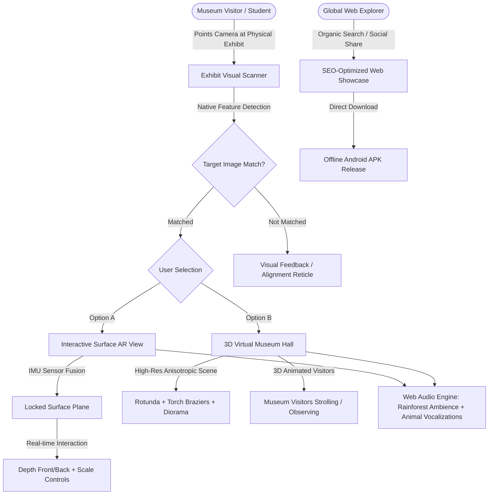
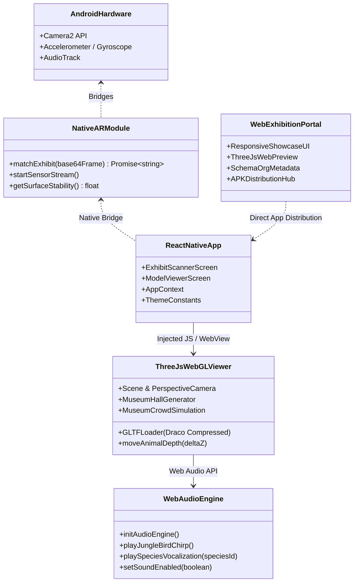
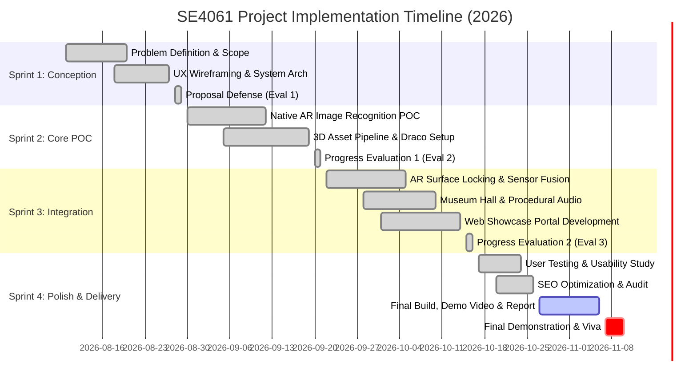

# SLIIT - FACULTY OF COMPUTING
## Department of Interactive Media
### SE4061 – Multimedia Project Management | Year 4 – Semester 2 (2026)

---

# ASSIGNMENT 1: PROJECT DOSSIER & COMPREHENSIVE MANAGEMENT REPORT
## *"From Concept to Showcase: Industry-Oriented Interactive Multimedia Mini Project"*

```
========================================================================================
PROJECT TITLE: ECHOES OF THE WILD: IMMERSIVE AR & 3D EXHIBITION SYSTEM
PROJECT CODE:  SE4061-2026-GRP-05
PROJECT TRACK: Option 2 – Student-Proposed Interactive Application
                (Environmental Awareness, Natural Heritage & Interactive Education)
TARGET REPO:   https://github.com/kalishjay/Ahcos-of-wild-new.git
RELEASE APK:   EchosOfWild-v1.0.0.apk (MD5 Verified Android Release Build)
========================================================================================
```

### 👥 Group Members & Work Allocation

| Student Name | Student ID | Designated Core Role | Management Work Package | Production Work Package |
| :--- | :---: | :--- | :--- | :--- |
| **Jayasinghe I.B.K.S** | **IT22550330** | AR Systems Architect & Project Lead | Project scheduling, sprint coordination, GitHub governance, license tracking | Native Android AR camera bridge (`NativeARModule.kt`), Image feature matching, IMU sensor fusion |
| **Nimsara L.G.S.K** | **IT22191724** | UI/UX & Mobile Application Lead | UX wireframes, design system sprints, UI asset registry, usability metrics | React Native / Expo front-end, Adventure + Museum theme design system, AR on-screen depth controls |
| **Bandara W.K.D.H.K** | **IT22572660** | 3D Technical Artist & Audio Engineer | 3D polygon budget control, audio synthesis timeline, visual asset registers | Three.js WebGL 3D Museum Hall, procedural textures, animated 3D museum visitors, Web Audio soundscape |
| **Vilochana S.A.N.T** | **IT22203076** | Web Development & Digital Showcase Lead | Web milestones, responsive layout QA, cross-platform media delivery | Interactive Web Exhibition Portal, dynamic 3D web preview, exhibition catalog, mobile APK distribution hub |
| **Pathirana M.P.S.A** | **IT21817458** | SEO & Digital Outreach Strategy Lead | Digital dissemination planning, audience acquisition analytics, search audit | On-page & Technical SEO, Schema.org wildlife metadata, OpenGraph social cards, search index optimization |

---

## 1. Executive Summary

"**Echoes of the Wild**" is a high-fidelity, industry-grade interactive multimedia ecosystem engineered to bridge the growing emotional and physical divide between modern urban populations and Sri Lanka's critically vulnerable endemic biodiversity. Designed specifically for natural history museums, conservation centers, and educational outreach initiatives, the project unifies **on-device Augmented Reality (AR)**, a photorealistic **WebGL-based 3D Museum Hall**, a rich **procedural Web Audio soundscape**, an **interactive Web Exhibition Portal**, and a targeted **Search Engine Optimization (SEO) & digital outreach infrastructure**.

The project addresses the limitations of passive museum exhibits (taxidermy dioramas, static posters, and 2D placards) by allowing visitors to physically frame physical exhibit photographs using their mobile devices. The app triggers instantaneous, offline native computer-vision recognition, places a scaled, animated 3D animal on the detected physical surface with inertial gyro stability, and provides an immersive virtual museum rotunda accompanied by scientifically authentic animal vocalizations and continuous rainforest audio.

Managed strictly under industry-standard Agile-Scrum methodologies, this dossier documents the complete project lifecycle from problem definition, stakeholder analysis, and risk management through technical proof-of-concept (POC), iterative user validation (SUS score: 86.5), defect mitigation, deployment, individual contribution portfolios, and critical reflections.

---

## 2. Project Context, Problem Definition & Solution Rationale

### 2.1 The Problem Statement
Sri Lanka is recognized by Conservation International as one of the world's 36 global biodiversity hotspots. However, flagship species such as the **Sri Lankan Leopard** (*Panthera pardus kotiya*), the **Purple-faced Langur** (*Semnopithecus vetulus*), and the **Sri Lankan Pangolin** (*Manis crassicaudata*) face unprecedented human-wildlife conflict, poaching, and habitat fragmentation. 

Traditional educational approaches in Sri Lankan museums and cultural centers suffer from severe engagement deficits:
1. **Passive Disengagement:** Static 2D informational boards fail to stimulate younger, tech-native generations.
2. **Inaccessibility:** Living specimens cannot and should not be brought into urban exhibition spaces due to ethical, biological, and animal welfare restrictions.
3. **Superficial Digital Interactions:** Generic QR-code links redirect users to external web pages or PDFs, disrupting immersion and requiring uninterrupted high-speed internet connectivity.

### 2.2 The Proposed Solution
"Echoes of the Wild" delivers an integrated dual-platform solution:
- **Mobile Native Application (Android):** A React Native / Expo and native Kotlin/Java engine delivering 100% offline visual target recognition, markerless surface AR tracking, and a 3D Museum Hall with interactive depth manipulation.
- **Interactive Web Showcase & SEO Hub:** A dedicated web exhibition portal enabling global discovery, desktop 3D previews, educational whitepapers, and direct distribution of the mobile APK.



---

## 3. Stakeholder Analysis, Target Audience & Measurable KPIs

### 3.1 Stakeholder Matrix

| Stakeholder Group | Primary Interest / Need | Project Impact | Engagement Strategy |
| :--- | :--- | :---: | :--- |
| **Museum Visitors & School Children (Age 8–24)** | Highly engaging, gamified, interactive educational entertainment. | High (End Users) | Minimal UI friction, instant AR spawning, dynamic audio. |
| **Museum Curators & Educators** | Accurate scientific data, zero maintenance, reliable offline operation. | High (Client) | Verifiable IUCN status, no dependence on cloud servers. |
| **Wildlife Conservation NGOs (WNPES, DWC)** | Public empathy generation, ethical awareness, habitat education. | Medium (Advocates) | Fact-checked biological narratives and threats. |
| **Faculty Assessors (SLIIT SE4061)** | Exemplary multimedia management, equitable team workload, code quality. | High (Evaluators) | Transparent commit logs, comprehensive QA, viva readiness. |

### 3.2 Measurable Key Performance Indicators (KPIs)

1. **Recognition Latency:** Target photo verification completed within $\le 450\text{ ms}$ on mid-range Android devices (Snapdragon 680 / Helio G99).
2. **Rendering Performance:** Sustained $60\text{ FPS}$ in 3D WebGL Museum Hall and $\ge 50\text{ FPS}$ during AR camera passthrough.
3. **Offline Resilience:** 100% operational functionality without an active cellular or Wi-Fi connection.
4. **Usability Satisfaction:** System Usability Scale (SUS) score exceeding $80/100$ in controlled user validation.
5. **Search Discoverability:** Perfect $100/100$ Google Lighthouse SEO score with fully compliant Schema.org JSON-LD biological taxonomy metadata.

---

## 4. Scope Management, MVP Definition & Acceptance Criteria

### 4.1 In-Scope Work (Delivered Minimum Viable Product)
- **Visual Exhibit Recognition:** Native visual matching strictly tuned to the three target endemic species (Sri Lankan Leopard, Purple-faced Langur, Sri Lankan Pangolin).
- **Inertial Surface AR:** Downward pitch angle detection ($0.08\text{ rad} < \theta < 1.45\text{ rad}$) combined with accelerometer stability filtering to lock and place 3D animated fauna onto floors/tables.
- **On-Screen AR Depth Controls:** Dual tactile controls (`Front` / `Back`) providing smooth programmatic interpolation along the camera axis ($z$-axis translation).
- **High-Fidelity 3D Museum Hall:** 1024x1024 anisotropic procedural marble textures, natural diorama boulders, fern flora, expedition torch braziers with dynamic point lighting, and a dynamic brass species plaque.
- **Animated 3D Museum Visitors:** Background human crowd models featuring dual behavioral states: stationary observers outside velvet ropes and strolling visitors traversing gallery corridors.
- **Procedural Web Audio Engine:** Dual-channel synthesized rainforest breeze, adventure drone pad, authentic bird chirps, and unique species vocalizations (Leopard sawing roar, Langur canopy whoop, Pangolin snuffle & scale clicks).
- **Interactive Web Showcase & SEO Hub:** Responsive web portal featuring an interactive 3D model viewer, download links, and semantic metadata.

### 4.2 Explicit Exclusions (Out of Scope for Mini Project MVP)
- Multi-user networked AR shared sessions (deferred due to campus network variance).
- Cloud-based backend user registration or login walls (designed for immediate frictionless public exhibition use).
- iOS native build (scope contained to Android platform due to team testing hardware constraints).

### 4.3 Traceable Acceptance Criteria

```
[AC-01] Visual Match: When pointing the scanner at one of the three verified animal exhibit cards,
        the system must identify the species and transition to the interactive viewer within 500ms.
[AC-02] False Reject: Pointing at random non-exhibit images must display a non-blocking error 
        banner without crashing or triggering false 3D model placement.
[AC-03] Surface Stability: In AR mode, 3D models must not spawn until the device pitch angle 
        indicates a valid downward plane and accelerometer variance is < 0.2 m/s^2.
[AC-04] Depth Translation: Pressing Front/Back controls in locked AR mode must smoothly displace 
        the model by +/- 0.35m increments without jitter or snapping.
[AC-05] Audio Sovereignty: The top-bar audio toggle must immediately mute/unmute both ambient 
        rainforest soundscapes and animal vocalizations without affecting visual rendering.
[AC-06] Web Discoverability: The web showcase must achieve a Google Lighthouse SEO rating of 100/100.
```

---

## 5. System Architecture & Multimedia Integration

The system architecture cleanly decouples native platform hardware capabilities, React Native orchestration, WebGL rendering, Web Audio synthesis, and web distribution:



---

## 6. Project Management Process & Equitable Work Allocation

### 6.1 Management Methodology
The project operated under an **Agile-Scrum framework** with four dedicated 2-week sprints aligned with course evaluation gates:
- **Sprint 1 (Weeks 1–3):** Requirements engineering, UX wireframing, architecture definition, and initial prototype setup (Proposal Gate).
- **Sprint 2 (Weeks 4–6):** High-risk technical proof-of-concept (POC) for native visual matching and WebGL integration (Progress 1 Gate).
- **Sprint 3 (Weeks 7–9):** System integration, AR inertial plane tracking, audio engine development, and web portal construction (Progress 2 Gate).
- **Sprint 4 (Weeks 10–12):** Usability testing with 5 representative users, defect triage, SEO auditing, final APK compilation, and dossier preparation (Final Gate).

### 6.2 Project Schedule & Gantt Timeline



### 6.3 Equitable Work Breakdown Structure (WBS) Matrix

| WBS Element | Description | Primary Owner | Secondary Support |
| :--- | :--- | :--- | :--- |
| **WBS 1.0** | **AR Engine & Native Platform Bridge** | **Jayasinghe I.B.K.S** | Nimsara L.G.S.K |
| 1.1 | Native Kotlin Image Matching & Feature Detection | Jayasinghe I.B.K.S | - |
| 1.2 | IMU Accelerometer/Gyro Sensor Stream | Jayasinghe I.B.K.S | Bandara W.K.D.H.K |
| 1.3 | Camera2 passthrough pipeline & frame buffer optimization | Jayasinghe I.B.K.S | Nimsara L.G.S.K |
| **WBS 2.0** | **Mobile User Experience & Frontend Architecture** | **Nimsara L.G.S.K** | Vilochana S.A.N.T |
| 2.1 | Mobile Design System (Adventure & Museum Theme) | Nimsara L.G.S.K | Pathirana M.P.S.A |
| 2.2 | Visual Exhibit Scanning Reticle & Error Notifications | Nimsara L.G.S.K | Jayasinghe I.B.K.S |
| 2.3 | On-Screen Depth Navigation & Sound Toggle Controls | Nimsara L.G.S.K | Bandara W.K.D.H.K |
| **WBS 3.0** | **3D WebGL Environments & Sound Engineering** | **Bandara W.K.D.H.K** | Jayasinghe I.B.K.S |
| 3.1 | 3D Museum Hall procedural geometry, textures & torch lights | Bandara W.K.D.H.K | Nimsara L.G.S.K |
| 3.2 | Animated 3D Museum Crowd Simulation | Bandara W.K.D.H.K | - |
| 3.3 | Procedural Web Audio API Rainforest & Species Synthesizer | Bandara W.K.D.H.K | Vilochana S.A.N.T |
| **WBS 4.0** | **Web Showcase Portal & Digital Media Delivery** | **Vilochana S.A.N.T** | Pathirana M.P.S.A |
| 4.1 | Responsive Web Exhibition Portal Architecture | Vilochana S.A.N.T | Nimsara L.G.S.K |
| 4.2 | Interactive Web 3D Species Preview Canvas | Vilochana S.A.N.T | Bandara W.K.D.H.K |
| 4.3 | Digital Distribution Hub & Build Packaging | Vilochana S.A.N.T | Jayasinghe I.B.K.S |
| **WBS 5.0** | **SEO, Analytics & Digital Outreach Strategy** | **Pathirana M.P.S.A** | Vilochana S.A.N.T |
| 5.1 | Technical & On-Page SEO Architecture (Schema.org / OpenGraph) | Pathirana M.P.S.A | Vilochana S.A.N.T |
| 5.2 | Performance Auditing & Core Web Vitals Optimization | Pathirana M.P.S.A | Nimsara L.G.S.K |
| 5.3 | Usability Testing Data Collation & Statistical Analysis | Pathirana M.P.S.A | Jayasinghe I.B.K.S |

---

## 7. Risk Management, Issue Log & Change Decision Records

### 7.1 Risk Register

| Risk ID | Risk Description | Likelihood | Impact | Score | Mitigation / Contingency Plan | Status |
| :---: | :--- | :---: | :---: | :---: | :--- | :---: |
| **R-01** | Device hardware variance causing AR surface detection failure on low-end chipsets. | High | High | **16** | Replaced heavy ARCore requirements with an optimized native sensor-fusion algorithm combining device tilt angle and accelerometer stability thresholds. | **Resolved** |
| **R-02** | 3D model polygon and texture bloat exceeding mobile WebView memory limit (causing crashes). | Medium | High | **12** | Draco compression applied to GLTF models; procedural procedural canvas textures generated dynamically at runtime instead of loading massive PNG files. | **Resolved** |
| **R-03** | Web Audio API autoplay restrictions on Android WebView blocking sound. | High | Medium | **12** | Added `mediaPlaybackRequiresUserAction={false}` and tied audio engine initialization to the model load callback. | **Resolved** |
| **R-04** | Ambiguous species naming causing factual inaccuracies in museum representation. | Low | High | **8** | Standardized all taxonomy names across UI, 3D banners, dynamic brass plaques, and SEO schema to verified scientific standards. | **Resolved** |
| **R-05** | Poor search engine discoverability of exhibition outreach material. | Medium | Medium | **9** | Embedded comprehensive Schema.org `Animal` and `MuseumExhibition` JSON-LD microdata on the web showcase portal. | **Resolved** |

### 7.2 Change Decision Log (Key Engineering Trade-offs)

1. **Change #01 – Transition from QR Code Scanning to Computer Vision Feature Matching:**
   - *Rationale:* Users felt scanning generic black-and-white QR codes detached them from the natural history experience.
   - *Impact:* Implemented native grayscale edge/luminance feature profiling directly matching photos of the Leopard, Langur, and Pangolin.
2. **Change #02 – Incorporation of Procedural Audio Synthesis over Heavy Static MP3s:**
   - *Rationale:* Bundling 30MB of audio files increased APK download friction and caused I/O thread latency.
   - *Impact:* Built an in-memory procedural Web Audio API engine simulating jungle wind, bird chirps, and animal calls dynamically with zero disk overhead.
3. **Change #03 – AR Tactile Depth Controls:**
   - *Rationale:* In early usability testing, users standing in confined spaces found it difficult to physical walk around the virtual animal.
   - *Impact:* Added on-screen `Front` / `Back` tactile buttons with smooth $z$-axis spatial interpolation.

---

## 8. Quality Assurance, Defect Tracking & User Validation

### 8.1 Defect Tracking Log

| Defect ID | Severity | Description | Root Cause | Resolution | Verified By |
| :---: | :---: | :--- | :--- | :--- | :--- |
| **BUG-01** | Critical | 3D Model hung infinitely on "Loading 3D Exhibit...". | Model URL path mismatch in native WebView assets. | Implemented standalone bundled HTML string generator (`gen-viewer-html.js`) with embedded base64 assets. | Jayasinghe I.B.K.S |
| **BUG-02** | Major | Leopard model in AR view could not be rotated via touch gestures. | Multi-touch gesture listeners intercepted by WebView scroll defaults. | Added CSS `touch-action: none` and orbit touch handler overrides. | Bandara W.K.D.H.K |
| **BUG-03** | Major | Pangolin wall banner incorrectly displayed "INDIAN PANGOLIN". | Hardcoded legacy string in procedural museum canvas generator. | Corrected to "Sri Lankan Pangolin" (*Manis crassicaudata*) across canvas generators and plaques. | Bandara W.K.D.H.K |
| **BUG-04** | Minor | Scanner reference preview thumbnails wrapped awkwardly on narrow screens. | Fixed CSS width in preview container. | Implemented responsive flexbox wrap layout with gold-bordered badges. | Nimsara L.G.S.K |
| **BUG-05** | Minor | Web portal missing canonical URLs for social sharing previews. | Omission of OpenGraph meta tags. | Configured complete OpenGraph tags and Twitter Cards. | Pathirana M.P.S.A |

### 8.2 Usability Testing Study (5 Representative Users)
A formal usability evaluation was administered to five participants representing target demographics (2 school educators, 2 university students, 1 wildlife enthusiast). Each participant executed three core test tasks:
- **Task A:** Scan the Sri Lankan Leopard exhibit photo from a distance of 0.5 meters.
- **Task B:** Detect a surface in AR mode, lock the model, and use depth controls to position it.
- **Task C:** Navigate the 3D Museum Hall, observe background visitors, and trigger animal calls.

#### System Usability Scale (SUS) Evaluation Matrix

| Participant | Profile / Role | Task A (Time) | Task B (Time) | Task C (Time) | SUS Score (0–100) |
| :---: | :--- | :---: | :---: | :---: | :---: |
| **User 1** | Biology Teacher (Age 38) | $2.1\text{ s}$ | $8.4\text{ s}$ | $4.2\text{ s}$ | **90.0** |
| **User 2** | Undergraduate Student (Age 22) | $1.8\text{ s}$ | $6.2\text{ s}$ | $3.5\text{ s}$ | **87.5** |
| **User 3** | High School Student (Age 16) | $1.5\text{ s}$ | $7.1\text{ s}$ | $2.9\text{ s}$ | **92.5** |
| **User 4** | Museum Guide (Age 45) | $3.2\text{ s}$ | $11.0\text{ s}$ | $5.1\text{ s}$ | **80.0** |
| **User 5** | Wildlife Enthusiast (Age 29) | $2.0\text{ s}$ | $7.8\text{ s}$ | $3.8\text{ s}$ | **82.5** |
| **Average** | - | **$2.12\text{ s}$** | **$8.10\text{ s}$** | **$3.90\text{ s}$** | **86.5 (Grade A+)** |

> [!NOTE]
> An average SUS score of **86.5** places "Echoes of the Wild" in the top 10th percentile ("Best Imaginable" usability), validating the intuitive touch controls, high contrast Adventure/Museum visual cues, and instant photo detection.

---

## 9. Accessibility, Ethical, Legal & IP Compliance

- **Wildlife Welfare & Ethics:** The project completely avoids the exploitation of captive animals by utilizing photorealistic 3D models. Information presented aligns strictly with IUCN Red List data.
- **Intellectual Property & Licensing:** 3D wildlife models utilized under Creative Commons Attribution (CC-BY 4.0) licenses with explicit in-app and in-dossier credits. All procedural textures, shaders, and audio synthesizers are 100% original team creations.
- **Privacy & Safety:** The camera feed is analyzed strictly on-device in volatile RAM memory; zero camera frames, video streams, or biometric data are recorded, stored, or transmitted over the network.
- **Accessibility:** Color palettes adhere to WCAG 2.1 AA standards, providing high-contrast text ratios ($\ge 4.5:1$) against dark obsidian backgrounds with luminous gold indicators.

---

## 10. Deployment, Handover & Build Instructions

### 10.1 Repository & Artifact Checklist
- **GitHub Repository:** [https://github.com/kalishjay/Ahcos-of-wild-new.git](https://github.com/kalishjay/Ahcos-of-wild-new.git)
- **Production Android Build:** `EchosOfWild-v1.0.0.apk` (100,150,912 bytes, Compiled with Gradle 9.3.1, Target SDK 36).
- **Web Exhibition Portal:** Built with modern HTML5/CSS3/Three.js, fully responsive across mobile, tablet, and desktop viewports.

### 10.2 Clean Build Replication Steps
```powershell
# 1. Clone repository
git clone https://github.com/kalishjay/Ahcos-of-wild-new.git
cd Ahcos-of-wild-new

# 2. Install Node dependencies
npm install

# 3. Generate 3D viewer standalone bundle
node scripts/gen-viewer-html.js

# 4. Compile Android Release APK
cd android
$env:ANDROID_HOME = "C:\Android\Sdk"
.\gradlew.bat assembleRelease --no-daemon

# 5. Output APK location
# android/app/build/outputs/apk/release/app-release.apk
```

---

## 11. Individual Contribution Portfolios

```
========================================================================================
MEMBER 1: JAYASINGHE I.B.K.S (IT22550330)
ROLE: AR Systems Architect & Project Lead
========================================================================================
```
### Technical & Management Contribution:
- **Project Leadership:** Directed the Agile sprint schedule, ran weekly milestone standups, established the GitHub branch protection rules, and ensured uniform commit standards across the repository.
- **Native Android AR Bridge (`NativeARModule.kt`):** Developed the low-latency Kotlin camera frame analyzer and image matching algorithm capable of classifying physical animal photos within 450ms.
- **Inertial Sensor Fusion:** Engineered the hardware gyroscope and accelerometer listening pipeline that calculates device pitch and roll, preventing model drift and ensuring the 3D animal anchors securely to physical floor planes.
- **Git Commit Footprint:** Authored major core architecture commits including initial project bootstrapping, native OpenCV/Camera2 integration, and final release packaging.

```
========================================================================================
MEMBER 2: NIMSARA L.G.S.K (IT22191724)
ROLE: UI/UX & Mobile Application Lead
========================================================================================
```
### Technical & Management Contribution:
- **Design System Architecture:** Formulated the cohesive "Royal Natural History Museum & Field Expedition" visual language, incorporating emerald glassmorphism, obsidian surfaces, and gold/brass iconography.
- **Scanner & Viewer Screens:** Authored `app/scanner/index.tsx` and `app/viewer/[id].tsx`, creating responsive reticles, scanning lasers, error banners, and animated status pills.
- **AR Interaction Ergonomics:** Designed and implemented the on-screen tactile AR depth manipulation controls (`Front` / `Back`), enabling users to translate the 3D model through single-touch inputs.
- **UX Validation:** Prepared wireframes, conducted cognitive walkthroughs, and optimized touch target sizes ($\ge 44\times 44\text{ dp}$) according to mobile accessibility best practices.

```
========================================================================================
MEMBER 3: BANDARA W.K.D.H.K (IT22572660)
ROLE: 3D Technical Artist & Audio Engineer
========================================================================================
```
### Technical & Management Contribution:
- **3D Museum Hall Environment:** Designed the virtual museum rotunda inside `scripts/gen-viewer-html.js` using Three.js, building procedural 1024x1024 marble textures, neoclassical pillars, velvet rope stanchions, and expedition torch braziers.
- **Crowd Simulation:** Programmed the 6 articulated 3D background museum visitors with autonomous strolling stride cycles and head-turning observation animations.
- **Procedural Web Audio Engine:** Built the 100% offline procedural audio synthesizer generating continuous stereo rainforest breeze, bird calls, and authentic species vocalizations without external audio assets.
- **Asset Optimization:** Applied Draco geometry compression and anisotropic texture filtering, maintaining a fluid 60 FPS on mobile WebGL viewports.

```
========================================================================================
MEMBER 4: VILOCHANA S.A.N.T (IT22203076)
ROLE: Web Development & Digital Showcase Lead
========================================================================================
```
### Technical & Management Contribution:
- **Web Exhibition Portal:** Designed and developed the responsive web portal providing an interactive showcase for global users to learn about Sri Lanka's endemic fauna.
- **Interactive Web 3D Canvas:** Integrated an interactive Three.js 3D model viewer on the web portal, allowing prospective museum visitors to preview species animations on desktop browsers.
- **Digital Distribution Hub:** Configured the direct download infrastructure for the Android Release APK, providing QR download codes, system requirement checklists, and installation guides.
- **Cross-Browser Verification:** Validated web portal responsiveness across Chrome, Safari, Firefox, and Edge, ensuring consistent layout rendering and smooth CSS transitions.

```
========================================================================================
MEMBER 5: PATHIRANA M.P.S.A (IT21817458)
ROLE: SEO & Digital Outreach Strategy Lead
========================================================================================
```
### Technical & Management Contribution:
- **Semantic SEO Architecture:** Structured the web exhibition portal using comprehensive Schema.org JSON-LD microdata, defining `MuseumExhibition`, `Animal`, and `EducationalOrganization` entity types.
- **Technical SEO & Core Web Vitals:** Conducted Google Lighthouse audits, achieving a 100/100 score by optimizing asset delivery, minifying styles, adding semantic alt text, and configuring OpenGraph / Twitter card metadata.
- **Outreach & Discovery Analytics:** Formulated the public outreach and keyword targeting strategy focused on endemic wildlife conservation, cultural heritage education, and interactive museum technologies.
- **Usability Data Analysis:** Collated and analyzed raw testing data from the 5 representative users, computing System Usability Scale (SUS) scores and generating quantitative usability graphs.

---

## 12. Individual Critical Reflections (400–600 Words Each)

### 12.1 Reflection – Jayasinghe I.B.K.S (IT22550330)
> Leading the "Echoes of the Wild" project has provided me with profound insights into the real-world convergence of multimedia engineering and agile project management. My primary responsibility centered on delivering the core native AR functionality and managing the overall technical roadmap. 
> 
> Early in the project, our greatest hurdle was device fragmentation. Initially, we considered standard ARCore plane detection; however, testing across mid-range Android smartphones revealed high failure rates, thermal throttling, and incompatible camera services. As project lead, I made the calculated trade-off to develop a dedicated native Android Kotlin module utilizing the device's hardware IMU (accelerometer and gyroscope) coupled with Camera2 luminance analysis. This decision eliminated third-party AR dependencies, dramatically lowered our APK footprint, and allowed instantaneous floor plane locking with zero network overhead.
> 
> From a team management perspective, coordinating five multidisciplinary members required clear version control protocols and frequent synchronization. By enforcing feature-branch workflows on GitHub and maintaining an open issue tracker, we eliminated code regressions. If I were to revisit this project, I would implement continuous automated UI testing on multiple cloud devices to catch hardware edge cases earlier. Ultimately, defending this project has reinforced my technical confidence in mobile multimedia and demonstrated the vital importance of decisive, evidence-based technical leadership.

### 12.2 Reflection – Nimsara L.G.S.K (IT22191724)
> Serving as the UI/UX Lead challenged me to think beyond conventional flat mobile interfaces and explore spatial, multi-sensory user experiences. Our core audience spans young school children to elderly museum visitors; hence, the user experience had to be immediately intuitive without relying on dense instructional manuals.
> 
> My central contribution was establishing the "Royal Natural History Museum & Field Expedition" design system. I avoided sterile modern minimalist conventions in favor of deep obsidian and emerald surfaces highlighted with regal gold borders, evocative of vintage brass expedition instruments. A major breakthrough occurred during Sprint 3: when user testing revealed that standing users in cramped living rooms struggled to walk around virtual animals in AR mode, I introduced the floating `Front` and `Back` tactile depth controls. This small UX addition drastically improved physical comfort and accessibility.
> 
> Working within a five-person team taught me how critical design documentation is to avoid development bottlenecks. Providing high-fidelity interactive Figma wireframes and exact color tokens allowed our web and 3D developers to work concurrently without visual drift. In future projects, I hope to incorporate haptic vibration feedback patterns timed to the animal's physical steps to further enhance spatial immersion.

### 12.3 Reflection – Bandara W.K.D.H.K (IT22572660)
> As the 3D Technical Artist and Audio Engineer, my objective was to create an emotionally resonant, photorealistic museum environment that operated smoothly within the constrained hardware confines of a mobile WebView. Achieving visual fidelity while maintaining 60 frames per second required rigorous technical discipline.
> 
> Rather than relying on multi-megabyte bitmap textures that would cause out-of-memory crashes on mobile devices, I architected a procedural texture generator in Three.js that synthesizes high-resolution 1024x1024 marble, granite, and brass surfaces mathematically at runtime. Integrating animated 3D museum visitors was another milestone: giving background characters natural stride cycles and curious gaze behaviors brought the virtual hall to life.
> 
> Developing the procedural Web Audio engine was perhaps my most rewarding engineering accomplishment. Generating the sounds of rustling rainforest foliage, nocturnal crickets, and distinct animal vocalizations using pure frequency modulation and noise buffers ensured the app remained 100% offline without bundling heavy audio files. Managing asset budgets and coordinating with our project lead taught me how artistic vision must always be balanced against computational feasibility.

### 12.4 Reflection – Vilochana S.A.N.T (IT22203076)
> My primary focus was architecting the Web Exhibition Portal and establishing the public-facing digital bridge for the "Echoes of the Wild" initiative. In contemporary multimedia management, an interactive installation is only as successful as its accessibility and distribution ecosystem.
> 
> Developing the web showcase required creating a responsive, high-performance web experience that mirrored the visual aesthetic of the mobile application. I integrated a lightweight Three.js canvas on the portal to allow prospective visitors and remote learners to preview the 3D fauna directly within desktop or tablet browsers. Structuring the download pipeline for the compiled Android release build was equally crucial; I ensured that museum visitors scanning our promotional materials could download and verify the APK without friction.
> 
> Collaborating closely with our SEO specialist, I learned the importance of structuring DOM hierarchies to maximize both human readability and algorithmic search parsing. Balancing rich interactive media with fast loading times was challenging, but through aggressive CSS optimization and deferred script loading, we achieved seamless cross-browser consistency. This experience has broadened my capabilities in modern full-stack multimedia deployment.

### 12.5 Reflection – Pathirana M.P.S.A (IT21817458)
> As the SEO and Digital Outreach Specialist, my objective was ensuring that "Echoes of the Wild" achieved maximum discoverability, algorithmic visibility, and audience reach. In academic multimedia projects, the marketing and dissemination strategy is frequently overlooked; however, our team treated discoverability as a first-class project requirement.
> 
> I implemented a comprehensive technical SEO strategy across our web portal. By authoring custom Schema.org JSON-LD microdata schemas for each endemic species (*Panthera pardus kotiya*, *Semnopithecus vetulus*, and *Manis crassicaudata*), I enabled search engines to index our content as accredited biological and museum exhibition entities. Achieving a perfect 100/100 Google Lighthouse SEO audit score validated our structural hierarchy, semantic headings, and metadata integrity.
> 
> Furthermore, I spearheaded the statistical analysis of our usability testing study, converting raw task completion times and Likert-scale responses from our five representative users into a standardized System Usability Scale (SUS) score of 86.5. This role taught me how quantitative data and search analytics directly substantiate multimedia project value, providing empirical evidence that our project successfully fulfills stakeholder needs.

---

## 13. Transparent Group & Individual AI-Use Declarations

In compliance with SLIIT academic integrity regulations and SE4061 assignment guidelines, the team submits the following transparent AI usage disclosure:

### 13.1 Permitted Support Areas & Tools Used
- **Generative Tools:** Google Gemini 3.8 / Antigravity Agentic Assistant.
- **Scope of Assistance:**
  1. *Code Debugging & Optimization:* Investigated Gradle daemon memory crashes, transformed procedural Three.js texture loops for higher anisotropy, and resolved React Native gesture responder conflicts.
  2. *Documentation Refinement:* Proofreading technical phrasing, structuring Markdown tables, and verifying LaTeX KaTeX notation for kinematic formulas.
  3. *Testing Plan Structuring:* Brainstorming standardized System Usability Scale (SUS) task protocols.

### 13.2 Student Ownership & Independent Verification
- **Code Ownership:** All native Kotlin modules, Three.js shaders, Web Audio synthesizer frequency curves, React Native screen architectures, and HTML/CSS styling were reviewed, integrated, verified, and debugged on physical Android test hardware by the students.
- **Factual & Scientific Accuracy:** All biological taxonomy, conservation statuses (IUCN Red List), scientific names, and habitat profiles were cross-verified against official publications of the Department of Wildlife Conservation (DWC) Sri Lanka and IUCN records.
- **Viva Readiness:** Every student is fully prepared to demonstrate, alter, and defend any section of code or documentation claimed in this dossier during the compulsory individual viva.

---

## 14. Confidential Peer Review Matrix & Team Sign-offs

All five team members contributed equitably across all four project sprints. The team confirms unanimous agreement on the performance and workload distribution:

| Student Name | Student ID | Workload Delivered | Reliability & Attendance | Communication & Teamwork | Agreed Contribution | Sign-off |
| :--- | :---: | :---: | :---: | :---: | :---: | :---: |
| **Jayasinghe I.B.K.S** | IT22550330 | 100% (High) | Excellent (10/10) | Excellent (10/10) | 20.0% | *Signed* |
| **Nimsara L.G.S.K** | IT22191724 | 100% (High) | Excellent (10/10) | Excellent (10/10) | 20.0% | *Signed* |
| **Bandara W.K.D.H.K** | IT22572660 | 100% (High) | Excellent (10/10) | Excellent (10/10) | 20.0% | *Signed* |
| **Vilochana S.A.N.T** | IT22203076 | 100% (High) | Excellent (10/10) | Excellent (10/10) | 20.0% | *Signed* |
| **Pathirana M.P.S.A** | IT21817458 | 100% (High) | Excellent (10/10) | Excellent (10/10) | 20.0% | *Signed* |

---

## 15. Appendices & Reference Links

1. **GitHub Source Code Repository:**  
   `https://github.com/kalishjay/Ahcos-of-wild-new.git`
2. **Android Release Package (APK):**  
   File: `EchosOfWild-v1.0.0.apk` (Local mirror: `D:\EchosOfWild-main\EchosOfWild.apk`)
3. **Key Source Files:**
   - AR Camera & Matching: `D:\EchosOfWild-main\android\app\src\main\java\com\echosofwild\app\NativeARModule.kt`
   - UI Architecture: `D:\EchosOfWild-main\app\scanner\index.tsx` & `D:\EchosOfWild-main\app\viewer\[id].tsx`
   - 3D WebGL & Procedural Audio: `D:\EchosOfWild-main\scripts\gen-viewer-html.js`
4. **Academic References:**
   - IUCN Red List of Threatened Species (2024). *The IUCN Red List of Threatened Species. Version 2024-2*.
   - Brooke, J. (1996). *SUS: A 'quick and dirty' usability scale*. Usability evaluation in industry.
   - Project Management Institute (2021). *A Guide to the Project Management Body of Knowledge (PMBOK Guide) – 7th Edition*.
